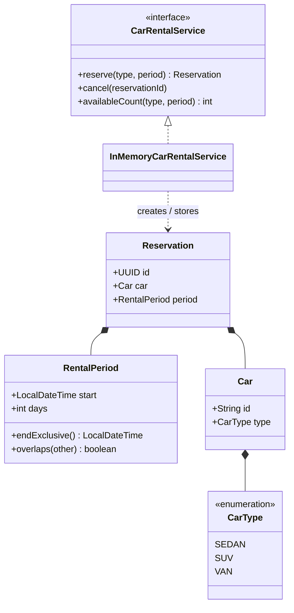

# Car Rental Reservation System

A self-contained, object-oriented implementation, written in **Java 17** with **JUnit 5** and **Maven**.

The solution reserves a specific car of a requested type for a start date/time and a positive number of days. It supports sedans, SUVs, and vans, enforces limited per-type inventory, prevents double-booking, and includes cancellation, availability lookup, a runnable demo, automated tests, and CI.

## Requirements traceability

| Requirement | Implementation | Automated proof |
| --- | --- | --- |
| Reserve a car type at a desired date/time for a number of days | `CarRentalService.reserve(...)` and `RentalPeriod` | `reservesRequestedCarTypeAndPeriod` |
| Support sedan, SUV, and van | `CarType` enum and typed fleet | `supportsAllRequiredCarTypes` |
| Limit the number of cars of each type | `InMemoryCarRentalService` fleet and availability check | `enforcesInventoryLimit`, `handlesPartialOverlap` |
| Apply object-oriented principles | Immutable value objects/entities, service interface, encapsulated implementation, domain exceptions | Domain and service test suites |
| Use unit tests | 21 JUnit tests covering business rules, validation, and concurrency | `./mvnw clean verify` |

## Quick start

### Prerequisite

Install **JDK 17 or newer** and verify it is active:

```bash
java -version
```

Maven does not need to be installed separately; the Maven wrapper downloads the configured Maven version on first use.

### Build and test

macOS / Linux:

```bash
chmod +x mvnw
./mvnw clean verify
```

Windows Command Prompt:

```bat
mvnw.cmd clean verify
```

A successful build runs all tests and creates:

- Executable application: `target/car-rental-system-1.0.0.jar`
- Coverage report: `target/site/jacoco/index.html`

### Run the demonstration

```bash
./mvnw exec:java
```

Or, after a successful build:

```bash
java -jar target/car-rental-system-1.0.0.jar
```

On Windows, replace `./mvnw` with `mvnw.cmd`.

## Core API example

```java
Map<CarType, Integer> inventory = new EnumMap<>(CarType.class);
inventory.put(CarType.SEDAN, 2);
inventory.put(CarType.SUV, 1);
inventory.put(CarType.VAN, 1);

CarRentalService rentalService = new InMemoryCarRentalService(inventory);
LocalDateTime start = LocalDateTime.of(2026, 11, 10, 10, 0);

Reservation reservation = rentalService.reserve(CarType.SEDAN, start, 3);

int remaining = rentalService.availableCount(
        CarType.SEDAN,
        new RentalPeriod(start, 3));

rentalService.cancel(reservation.id());
```

A reservation returns its unique reservation ID, the selected car ID and type, and the confirmed rental period. `NoCarAvailableException` is thrown when all cars of the requested type overlap the request.

## Business rules and assumptions

- A rental period is the half-open interval **[start, end)**. The end is calculated as `start.plusDays(days)` and retains the requested local time.
- Rentals that touch at an endpoint do **not** overlap. A car returned at 10:00 can be reserved by another customer at 10:00.
- Any partial or complete time overlap prevents the same car from being reserved again.
- Inventory is configured per car type. Zero inventory is valid; missing, null, or negative counts are rejected.
- A reservation is assigned to one physical car, not merely to a car-type counter.
- Cancelling an unknown or already-cancelled reservation throws `ReservationNotFoundException`.
- The in-memory implementation is process-local and does not persist data after restart.
- Customer identity, pricing, payments, maintenance, authentication, and a web interface are intentionally outside this assessment's scope.

## Design overview



See [docs/DESIGN.md](docs/DESIGN.md) for the reservation algorithm, concurrency model, complexity, and production evolution path.

## Test strategy

The suite proves both the stated requirements and important boundary conditions:

- All three car types and exact reservation details
- Full, partial, containing, adjacent, and separated date/time intervals
- Inventory exhaustion without affecting other car types
- Cancellation and inventory release
- Invalid arguments and fleet configurations
- Immutable, chronologically sorted reservation snapshots
- Twelve simultaneous requests competing for one remaining car, with exactly one success

The core domain and service code has **100% line and branch coverage**. The console demonstration is excluded from this metric and is smoke-tested through the packaged JAR.

Run only the tests:

```bash
./mvnw test
```

## Project structure

```text
car-rental-system/
├── .github/workflows/ci.yml       # GitHub Actions build and coverage artifact
├── .mvn/wrapper/                  # Portable Maven configuration
├── docs/DESIGN.md                 # Design decisions and interview-ready detail
├── src/main/java/.../domain/      # Car, CarType, RentalPeriod, Reservation
├── src/main/java/.../service/     # Service contract, implementation, exceptions
├── src/main/java/.../CarRentalApplication.java
├── src/test/java/                 # JUnit 5 requirement and boundary tests
├── pom.xml
└── README.md
```

## Deliberate trade-offs

- **Enum instead of car subclasses:** sedan, SUV, and van differ only by category in the requirements; inheritance would add complexity without adding behavior.
- **Records for immutable domain values:** they provide concise construction, value equality, and safe sharing while keeping validation in compact constructors.
- **Service interface:** callers depend on a stable contract, allowing the in-memory implementation to be replaced by a persistent implementation later.
- **In-memory storage:** appropriate for a small OOP assessment and keeps the project runnable with only a JDK.
- **No REST API, frontend, or database:** these would not improve proof of the requested reservation logic within the stated 2–4 hour exercise.

## Production evolution

For a multi-instance production service, move reservation selection and insertion into one database transaction, use appropriate row locking or database constraints, and add optimistic retry handling. A REST adapter can then expose the existing service contract without changing the domain rules. Further extensions could include customer records, pricing, maintenance windows, time-zone-aware location scheduling, metrics, and integration tests.

## Author

Nivetha Somasundaram
